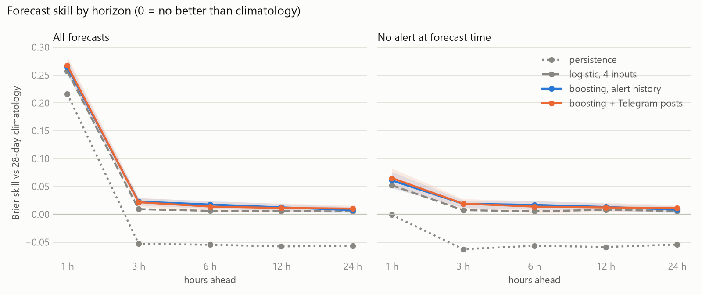
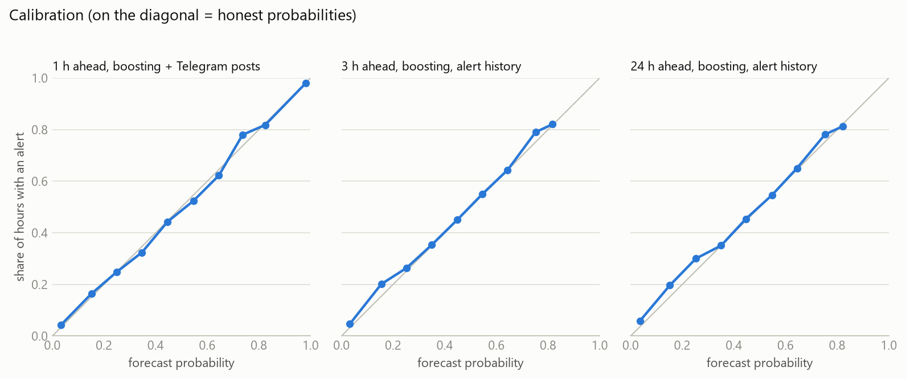

# Air raid alert forecast

Hourly probability of an air raid alert for 24 regions of Ukraine, 1 to 24 hours ahead.
Stage 2 project for the KSE Agentic AI School.

## The task

At the end of every hour, for every region, the model answers one question:
what is the probability that an alert is active during the hour that is 1, 3, 6, 12 or 24 hours ahead?

The forecast time is the end of the last finished hour. Everything the model sees was published before that moment.

## Result in short

Scored once on the last 28 days (2026-09-13 to 2026-10-11), 16,128 forecasts per horizon.

- **One hour ahead works.** Brier skill 0.267 against climatology. Inside a region the model ranks hours with AUC 0.76.
- **New alerts are much harder.** When no alert is on at forecast time (88% of forecasts), skill is 0.065.
- **Past one hour, alert history gives almost nothing.** Skill is 0.023 at 3 hours and 0.007 at 24 hours.
- **Telegram posts did not hold up.** They added 0.025 on validation and 0.004 on test, which is not distinguishable from zero.

## Data

| Source | What it gives | Period used |
|---|---|---|
| [ukrainian-air-raid-sirens-dataset](https://github.com/Vadimkin/ukrainian-air-raid-sirens-dataset), `volunteer_data_en.csv` | start and end of every alert per region | 2025-01-01 to 2026-10-11 |
| Air Force channel [t.me/s/kpszsu](https://t.me/s/kpszsu) | 26,338 text posts about drones, missiles and aviation | 2026-04-01 to 2026-10-11 |

The exact versions are recorded in `data/raw/source.json` and `data/raw/kpszsu_source.json`. Raw files are downloaded, not stored in the repo.

## Parts

| File | What it does |
|---|---|
| `alerts/data.py` | Downloads the alert file, cleans it, and builds the hourly panel: minutes under alert per region per hour, and whether an alert was still on at the end of the hour. |
| `alerts/telegram.py` | Downloads channel posts from the public web preview, page by page, with checkpoints. |
| `alerts/text.py` | Turns posts into hourly counts per region: posts that mention the region, and posts that say something is heading to it. |
| `alerts/features.py` | Builds the model inputs and the target for one horizon, and splits rows by time. |
| `alerts/models.py` | Three baselines (climatology, persistence, logistic regression on 4 inputs) and gradient boosting with and without text features. |
| `alerts/evaluate.py` | Metrics and a bootstrap interval that resamples whole days. |
| `alerts/run.py` | Fits every method and scores it on the validation or the test window. |
| `alerts/experiments.py` | Ablation on the validation window: other regions on or off, length of history. |
| `alerts/report.py` | Charts and result tables from a finished run. |
| `tests/` | 47 tests. The important ones check that no feature can see the future. |
| `reports/` | Metrics, tables and charts from the runs described here. |

## How leakage is prevented

1. **Features use finished hours only.** A forecast made at 14:00 uses alerts and posts up to 13:59:59.
2. **A test proves it.** It replaces every value after a cut point with its opposite and checks that no feature before the cut changes. Nine deliberate leaks were planted to confirm the test fails on each.
3. **The split respects label time.** A training row is used only if its answer was already known before the first forecast of the evaluation window.
4. **Choices are made on a validation window** (2026-08-16 to 2026-09-13). The test window was run once, after the model choice was committed.
5. **Edited posts.** They keep their timestamp but their text is ignored, because it may have changed after publication.

## Results on the test window

Brier skill against 28-day climatology. 0 means no better than climatology.

| Method | 1 h | 3 h | 6 h | 12 h | 24 h |
|---|---|---|---|---|---|
| persistence | 0.216 | -0.053 | -0.055 | -0.058 | -0.056 |
| logistic, 4 inputs | 0.257 | 0.009 | 0.006 | 0.006 | 0.005 |
| boosting, alert history | 0.264 | 0.023 | 0.017 | 0.012 | 0.007 |
| boosting + Telegram posts | 0.267 | 0.022 | 0.014 | 0.011 | 0.010 |

The chosen model uses Telegram posts at 1 hour and alert history only after that. This was fixed on validation. With 95% intervals:

| Forecasts | 1 h | 3 h | 6 h | 12 h | 24 h |
|---|---|---|---|---|---|
| All | 0.267 (0.252 to 0.284) | 0.023 (0.016 to 0.029) | 0.017 (0.010 to 0.024) | 0.012 (0.006 to 0.019) | 0.007 (0.002 to 0.013) |
| No alert at forecast time | 0.065 (0.048 to 0.083) | 0.019 (0.012 to 0.025) | 0.017 (0.009 to 0.024) | 0.013 (0.006 to 0.020) | 0.008 (0.002 to 0.014) |



The probabilities are honest. At 1 hour, in every 10-point band the forecast and the observed alert rate differ by at most 0.04.



Pooled AUC over all regions is 0.86 at 1 hour, but much of that is knowing which regions are busy. Inside a region it is 0.76 at 1 hour and 0.55 at 24 hours.

## Why the Telegram gain disappeared

Gain of boosting with posts over boosting without, at 1 hour:

| Window | Gain | 95% interval | By week |
|---|---|---|---|
| validation | 0.025 | 0.015 to 0.033 | 0.021, 0.029, 0.030, 0.017 |
| test | 0.004 | -0.004 to 0.013 | 0.018, 0.002, 0.002, -0.003 |

The channel changed. It posted 101 times a day in the fit period, 180 in validation and 255 in test. The share of posts that name a region in a form the patterns know fell from 88% to 79%, because the channel started naming towns and city districts.
The gain is there in the first week after fitting and gone after that. A model frozen for four weeks goes stale.

## What was tried and dropped

- **Richer text features**: towns mapped to regions, topic counts, posts in the last 20 minutes, volume ratios. Validation skill at 1 hour was 0.3133 against 0.3130 for the simple version, so they were removed.
- **Shorter training history.** Fitting from May 2026 instead of January 2025 was worse at every horizon. Fitting from 2023 was better by about 0.001 at 1 hour, which is noise, so 2025 stayed.
- **Own region only.** Dropping the other regions' current state costs 0.006 at 1 hour and changes nothing clear after that.

## Problems found in the data

- **The official file is frozen.** It stopped on 2026-09-07 while the repo still gets daily commits. The volunteer file is current, so it is the main source.
- **Fake long alerts.** All 18 alerts longer than 12 hours between January 2024 and August 2026 have almost no matching official alert. They are missed all-clear messages. They are cut to start plus 30 minutes, the rule the dataset itself uses for a missing end.
- **The end of the file is incomplete.** Alerts still running at snapshot time are not in the file, so the last 12 hours are dropped.
- **Labels are noisy.** The volunteer and official files agree on 82 to 89% of region-hours.
- **Little memory.** Hourly autocorrelation of alerts is 0.36 at one hour and below 0.1 from two hours on.

## Limits

- One 28-day test window and a model fitted once. Refitting every week is the obvious next step and was not run.
- Region level only. Since late 2025 real alerts are declared per district.
- Hourly steps. A 15-minute step would suit alerts that last 20 minutes.
- Cutting a fake long alert uses its final length, which is not known live.
- Luhansk is excluded: its permanent alert is not in the data.

## Run

```
python -m venv .venv
.venv\Scripts\pip install -r requirements.txt
.venv\Scripts\python -m alerts.data
.venv\Scripts\python -m alerts.telegram
.venv\Scripts\python -m pytest
.venv\Scripts\python -m alerts.run val
.venv\Scripts\python -m alerts.run test
.venv\Scripts\python -m alerts.report test
```

The downloads fetch the newest data, so numbers will move if you run them on a later day.
